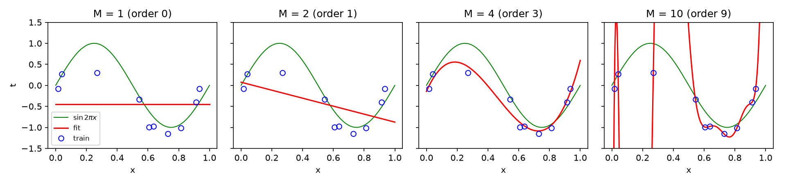
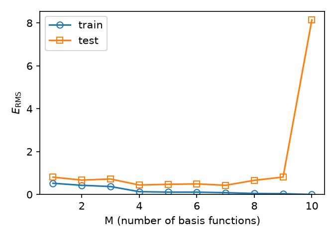

# 1.2 Linear regression

**What:** Polynomial-basis linear regression in NumPy, three ways: maximum likelihood (closed form), ridge (regularized closed form) and LMS (sequential SGD). Reproduces B&B's overfitting experiment: $t = \sin(2\pi x) + \epsilon$, $N = 10$.

**Why:** The closed-form solution, the projection geometry, and the link between regularization and conditioning come back in every later model (GPs at 1.10, polynomial response surfaces in MDAO). LMS is the simplest case of the SGD used to train neural nets.

Theory: [notes/phase1-linear-regression.md](../../notes/phase1-linear-regression.md) (B&B §4.1).

## Spec

**`linreg.py`** (Ties writes):

| Function | Input → Output |
|---|---|
| `poly_features(x, M)` | `x (N,)` → `Phi (N, M)`, columns $x^0, \dots, x^{M-1}$ |
| `fit_ml(Phi, t)` | → `w (M,)`, least squares without an explicit inverse |
| `fit_ridge(Phi, t, lam)` | → `w (M,)` |
| `noise_var(Phi, t, w)` | → scalar $1/\beta_{\text{ML}}$ |
| `rms(Phi, t, w)` | → scalar $E_{\text{RMS}}$ |
| `fit_lms(Phi, t, lr, n_epochs, rng)` | → `w (M,)`; start at 0, shuffle each epoch with `rng` |

$M$ is the number of basis functions (B&B §4.1 convention); polynomial order is $M - 1$. No `np.polyfit` or scikit-learn.

**Acceptance tests** (`test_linreg.py`):
1. Exact recovery: noiseless data from a known `w` → `fit_ml` returns it to `1e-10`, without `np.linalg.inv`.
2. Orthogonality: $\boldsymbol{\Phi}^T(\mathbf{t} - \boldsymbol{\Phi}\mathbf{w}) = \mathbf{0}$; residuals sum to 0.
3. Ridge: `lam=1e-12` matches ML; $\|\mathbf{w}\|$ decreases with $\lambda$; stationarity $\boldsymbol{\Phi}^T(\mathbf{t} - \boldsymbol{\Phi}\mathbf{w}) = \lambda\mathbf{w}$; finite solution for $M > N$.
4. `noise_var` within 5% of the true $\sigma^2$ for $N = 10^4$.
5. LMS: converges to `fit_ml` (`1e-3`) for `lr = 0.1/max‖φ_n‖²`; reproducible with a fixed seed; diverges for `lr = 2.5/min‖φ_n‖²`.

**Deliverables:** `run.py` writes `results/fits.png` (fits for $M \in \{1, 2, 4, 10\}$) and `results/rms_vs_M.png` (train/test $E_{\text{RMS}}$ vs. $M$).

## Usage
```
uv run pytest phase1_fundamentals/02_linear_regression
uv run python phase1_fundamentals/02_linear_regression/run.py
```

## Result
$N = 10$ training points, $N_{\text{test}} = 100$, noise $\sigma = 0.3$, seed 0, ML fit (`fit_ml`).





| M | train RMS | test RMS | ‖w‖ |
|---|---|---|---|
| 1 | 0.524 | 0.809 | 4.5e-01 |
| 2 | 0.428 | 0.671 | 9.5e-01 |
| 3 | 0.371 | 0.723 | 4.3e+00 |
| 4 | 0.131 | 0.442 | 3.6e+01 |
| 5 | 0.111 | 0.474 | 2.9e+01 |
| 6 | 0.109 | 0.495 | 1.2e+02 |
| 7 | 0.085 | 0.428 | 1.9e+03 |
| 8 | 0.047 | 0.661 | 1.9e+04 |
| 9 | 0.037 | 0.814 | 1.3e+05 |
| 10 | 2.2e-10 | 8.145 | 6.0e+06 |

- **Underfit (M = 1–3):** train and test error both high; the model cannot represent $\sin 2\pi x$.
- **Best range (M = 4–7):** test RMS ≈ 0.43–0.49. Floor is above $\sigma = 0.3$: with $N = 10$ the fitted weights still vary strongly with the noise sample (variance term, step 1.3).
- **Overfit (M ≥ 8):** train error keeps falling, test error rises. At M = 10 the fit interpolates all 10 points (train RMS 2e-10, round-off) and test RMS jumps to 8.1.
- **Weights blow up:** ‖w‖ grows by 7 orders of magnitude; large terms of opposite sign cancel at the data points and swing wildly between them (gaps at x ≈ 0.05–0.55). This is what ridge penalizes.
- **Conditioning:** cond(Φ) ≈ 2e8 at M = 10 on x ∈ [0, 1]; `lstsq` (SVD) still reaches round-off-level residuals, the normal equations would square this to ≈ 5e16.

**Engineering takeaway:** a polynomial response surface with as many terms as samples matches every sample and is useless between them; judge surrogates on held-out points.
